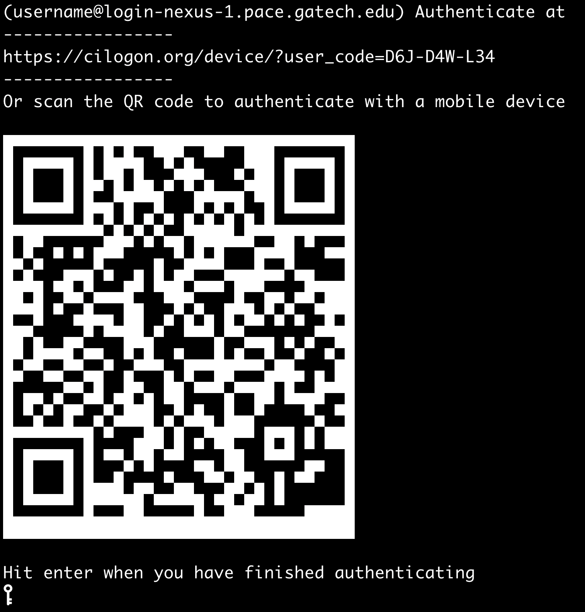

# Logging In

Before logging in to Nexus using `ssh` or other methods, make sure you have the following:

1. An ACCESS allocation on the Nexus system
2. A Nexus username (sent to you by email)

If you don't have both of these yet, complete those steps first. Instructions for requesting an ACCESS allocation on Nexus are on the [ACCESS website](https://allocations.access-ci.org/how-to). Once your allocation is approved, you'll receive your Nexus username by email. Use it with the login instructions below.

## Log In Using SSH

### Prerequisites

To log in directly with SSH, you will need:

* An SSH client
* A web browser, or a mobile device with a camera

### Steps

**1) Open a terminal application.**

Both macOS and Linux machines include the OpenSSH utility `ssh` in the built-in Terminal application. On Windows machines, you can use the built-in OpenSSH client in PowerShell or a third-party application such as PuTTY, MobaXterm, or Xshell.

**2) Enter your login information.**

In a terminal, run the following command:

    ssh username@login-nexus-1.pace.gatech.edu

Replace `username` with your assigned Nexus username, then press `Return` or `Enter`.

If you're using a third-party application, enter the following settings and start the session:

    Hostname:        login-nexus-1.pace.gatech.edu
    Username:        <YourNexusUsername>
    Connection type: SSH
    Port:            22

**3) Complete multi-factor authentication.**

You will then be prompted to complete an authentication step:

Follow the instructions on screen, either by opening the URL provided or by scanning the QR code. **Be sure to sign in with the same credentials associated with your ACCESS account.** Login will fail if you use a different institutional credential.

After authenticating, return to your terminal and press `Return` or `Enter` to finish logging in.

> ### More Login Options Coming Soon!
>
> Check back here for new ways to access Nexus, including:
>
> 1. Cybershuttle
> 2. VS Code
> 3. JupyterHub
> 4. Open OnDemand
